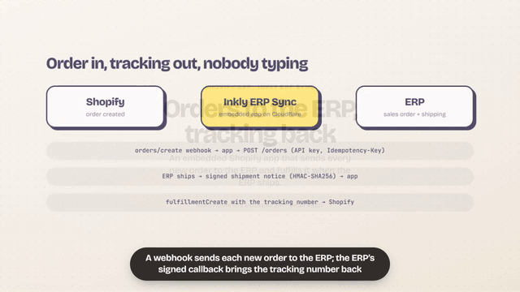
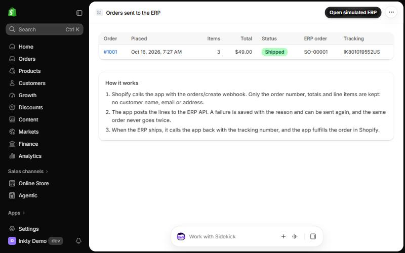
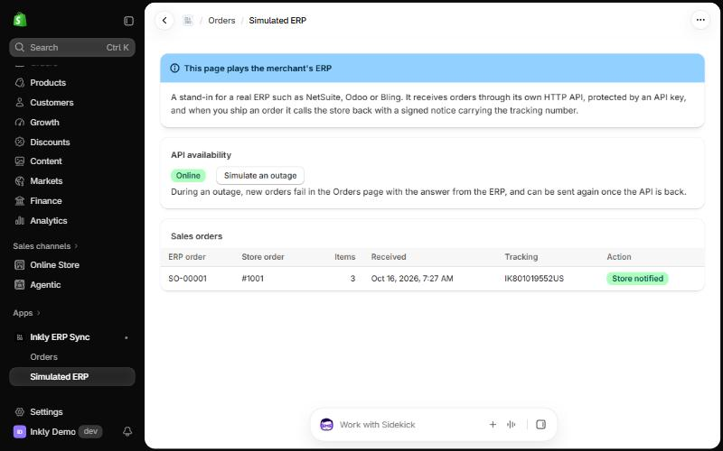
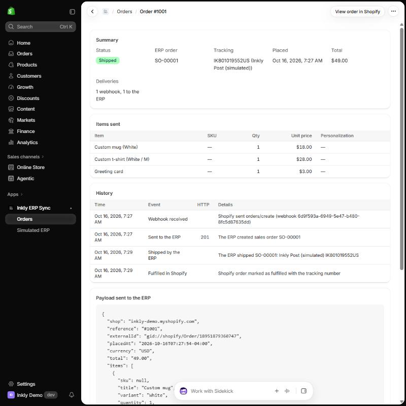
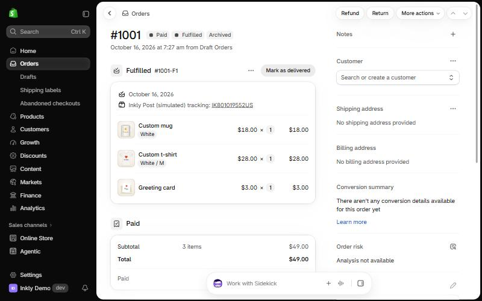

# Inkly ERP Sync: Shopify orders to an ERP, tracking back

A small custom Shopify app, embedded in the admin, that does the integration merchants ask freelancers for most often: **every new order goes to the ERP the moment it is created, and when the ERP ships it, the tracking number comes back and the order is fulfilled in Shopify.** Failures are visible and recoverable from the admin instead of disappearing into a log.

- Demo store: `inkly-demo.myshopify.com` (development store, fictional products, no order is ever shipped).
- The ERP is simulated inside the app, behind its own HTTP API, so the whole round trip can be shown without a client's system. Swapping in a real ERP means replacing one client module (see [Connecting a real ERP](#connecting-a-real-erp)).
- Runs on **Cloudflare Workers with D1** (free plan), in development as well as in production. The demo store's copy is installed as a custom app and served by the Worker: a test order there reached the ERP in under half a second, and shipping it fulfilled the order in Shopify with the tracking number.
- Built on the official [Shopify app template for React Router](https://github.com/Shopify/shopify-app-template-react-router) (`main-cli`, commit `ea3008d`, MIT), generated with `shopify app init`. The first commit is the untouched template; everything after it is this app.



Order #1001 on the demo store, from the webhook to the tracking number:

| Orders sent to the ERP | The simulated ERP |
|---|---|
|  |  |
| **The order in the app** | **Back in Shopify** |
|  |  |

## How it works

```
Shopify ── orders/create webhook ──▶ App ── POST /orders (API key, Idempotency-Key) ──▶ ERP
                                      │                                                  │
                                      │◀── signed shipment notice (HMAC-SHA256) ─────────┘
                                      │
                                      └── fulfillmentCreate with tracking number ──▶ Shopify
```

1. **Order created.** Shopify calls `/webhooks/orders/create`. The app checks the webhook signature, saves the order once (a unique key on shop + order id absorbs Shopify's duplicate deliveries, even concurrent ones) and posts it to the ERP.
2. **Sent to the ERP.** The request carries an API key and an `Idempotency-Key`, and gives up after 3 seconds so the webhook still answers inside Shopify's 5-second window. Success stores the ERP's sales order number; a failure stores the HTTP status and the reason.
3. **ERP ships.** The ERP calls `/webhooks/erp/shipments` with the tracking number. The body is signed with HMAC-SHA256 and the app verifies it in constant time before trusting it.
4. **Back in Shopify.** The app looks up the order's open fulfillment orders and calls `fulfillmentCreate` with the tracking number (customer notification off on the demo store).

Every step is written to the order's history, which the admin page shows as a timeline.

## Decisions worth a look

- **No customer personal data leaves Shopify.** The webhook subscription uses `include_fields`, so the payload carries only the order number, totals and line items: no name, email, phone or address. Line item properties starting with `_` (the theme's hidden preview and crop data) are dropped; what the buyer typed (text, font, color) goes to production. Code: `shopify.app.toml`, `app/integration/order-payload.ts`.
- **The webhook answers 200 even when the ERP is down.** The order is already saved with the failure, so the app owns the retry ("Retry failed orders" in the admin). Letting Shopify retry instead would hide the problem and, after repeated failures, get the subscription flagged. Code: `app/routes/webhooks.orders.create.tsx`, `app/integration/order-sync.server.ts`.
- **Nothing is sent twice.** Duplicate webhooks are counted, logged and ignored; the ERP request is idempotent by `shop/order id`, so a retry after a timeout cannot create a second sales order.
- **Fulfillment through fulfillment orders.** The app only asks for `read_orders` and the merchant-managed fulfillment order scopes, which is what `fulfillmentCreate` needs for orders shipped from the merchant's own locations.
- **Polaris web components** (`s-page`, `s-table`, `s-badge`, `s-banner`) from the template, no extra UI library.
- **Cloudflare Workers instead of a Node server.** The template targets Node with Prisma on a SQLite file. Here `@cloudflare/vite-plugin` runs the same React Router app inside `workerd` (also during `shopify app dev`, so dev and production behave the same), and Prisma keeps its API through the Rust-free client and the D1 driver adapter. Two Workers rules shaped the code: no I/O in the global scope (the Prisma session storage is created on first use, `app/session-storage.server.ts`) and calls to the Worker's own public URL need the `global_fetch_strictly_public` flag (the simulated ERP and its callback). The bundle is about 1 MB gzipped, under the free plan's 3 MB.

## The simulated ERP

The **Simulated ERP** page in the app plays the merchant's ERP. It lists the sales orders it received, has a switch to **simulate an outage** (its API answers `503`) and a **Ship** button that generates a tracking number and calls the store back. It lives in `app/erp-simulator/` and talks to the integration only over HTTP:

```http
POST /erp/api/orders
Authorization: Bearer <ERP_API_KEY>
Idempotency-Key: inkly-demo.myshopify.com/gid://shopify/Order/6912345678901
Content-Type: application/json

{
  "shop": "inkly-demo.myshopify.com",
  "reference": "#1004",
  "externalId": "gid://shopify/Order/6912345678901",
  "placedAt": "2026-10-15T21:14:03-04:00",
  "currency": "USD",
  "total": "18.00",
  "callbackUrl": "https://<app>/webhooks/erp/shipments",
  "items": [
    { "sku": "MUG-WHITE", "title": "Custom mug", "variant": "White", "quantity": 1,
      "unitPrice": "18.00", "customization": { "Text": "Good morning, Ana", "Font": "Pacifico", "Text color": "Orange" } }
  ]
}
```

`201 {"number": "SO-00004", "status": "received"}` for a new order, `200` with `"duplicate": true` for a repeated key, `401` for a wrong key, `422` with the invalid field, `503` during an outage.

The shipment notice it sends back:

```http
POST /webhooks/erp/shipments
X-Erp-Signature: sha256=<hex HMAC of the body with ERP_WEBHOOK_SECRET>

{ "shop": "inkly-demo.myshopify.com", "externalId": "gid://shopify/Order/6912345678901",
  "erpNumber": "SO-00004", "trackingNumber": "IK473124829US", "carrier": "Inkly Post (simulated)",
  "trackingUrl": null, "shippedAt": "2026-10-16T01:00:00.000Z" }
```

### Connecting a real ERP

Replace `app/integration/erp-client.server.ts` (one function: send an order, return the ERP's number or the error) with the real ERP's API, point `ERP_API_URL` at it, and map its shipment webhook, or a polling job, to `applyShipmentNotice`. The order storage, retries, history and fulfillment stay as they are.

## Run it

You need Node 22+, the [Shopify CLI](https://shopify.dev/docs/apps/tools/cli) and a Shopify Partner or Dev Dashboard account with a development store.

```bash
npm install
```

```bash
npm run graphql-codegen
```

```bash
npm run dev
```

`npm run dev` is `shopify app dev`: it links the app, starts a tunnel, applies the migrations to a local D1 database (`.wrangler/state`) and runs the app in `workerd` through Vite, then prints the URL to install the app on your store. Then create a test order (Orders, Create order, Product, pick one, Mark as paid, Create order) and open the app. Orders created in the admin carry no line item properties; to see the personalization fields reach the ERP, place the order through the storefront with Shopify's test payment.

Before the first run, the app needs a distribution method in the Dev Dashboard (custom distribution for a single store): Shopify blocks the `orders/create` webhook, even on development stores, until protected customer data access is set up.

Checks:

```bash
npm test
```

```bash
npm run typecheck
```

```bash
npm run lint
```

### Deploy to Cloudflare

Once, create the database and put its id in `wrangler.jsonc` (and the account id, if the login has more than one account):

```bash
npx wrangler d1 create inkly-erp-sync
```

```bash
npm run db:migrate:remote
```

Set the variables of the Worker (the API key and app URL can be plain vars; the secret must be a secret):

```bash
npx wrangler secret put SHOPIFY_API_SECRET
```

Then build and deploy the Worker, point the app at its URL (`application_url` and `redirect_urls` in `shopify.app.toml`) and release the app configuration:

```bash
npm run deploy:worker
```

```bash
npm run deploy
```

New migrations: change `prisma/schema.prisma`, then generate the SQL against the local database and apply it with wrangler:

```bash
npx prisma migrate diff --from-local-d1 --to-schema-datamodel prisma/schema.prisma --script -o migrations/0002_name.sql
```

### Environment variables

The Shopify CLI provides `SHOPIFY_API_KEY`, `SHOPIFY_API_SECRET`, `SCOPES` and `SHOPIFY_APP_URL`. The ERP settings are optional:

| Variable | Default | Meaning |
|---|---|---|
| `ERP_API_URL` | `<app url>/erp/api` | Base URL of the ERP API |
| `ERP_API_KEY` | derived from the app secret | Bearer key the ERP expects |
| `ERP_WEBHOOK_SECRET` | derived from the app secret | Shared secret for the shipment notice signature |

The defaults exist because the simulated ERP ships inside the app; with a real ERP, set all three.

## Project structure

```
app/integration/     the integration: payload mapping, ERP client, order sync service, fulfillment, signatures
app/erp-simulator/   the simulated ERP: API handler, validation, tracking numbers
app/routes/          webhooks (orders/create, ERP shipments), ERP API, admin pages (orders, order detail, ERP)
app/ui/              formatting helpers for the admin pages
prisma/              Prisma schema (sessions, order syncs, history, ERP tables)
migrations/          SQL migrations applied to D1 by wrangler
workers/             Cloudflare Worker entry
wrangler.jsonc       Worker config: D1 binding, compatibility flags
test/                vitest: payload mapping, signatures, ERP validation, tracking numbers, shipment notices
docs/screenshots/    the screenshots above, taken on the demo store
```

Author: Gabriel Velozo.
